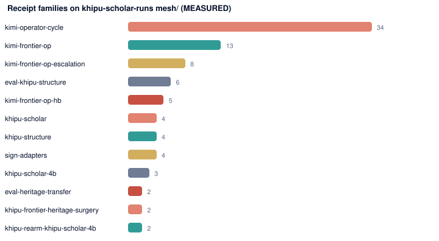

# SZL Energy Hologram — Measured Joules, Hash-Chained

Measured joules, hash-chained: the estate's energy accounting surface over real measurement data.

---

## Status — measured live 2026-11-14

**RUNNING** on `cpu-basic` shared hardware · **Live:** <https://szlholdings-szl-energy-hologram.hf.space> · deployed revision [`2b8f4e6116`](https://huggingface.co/spaces/SZLHOLDINGS/szl-energy-hologram/tree/main)

## Estate provenance

🜂 **SZL Holdings estate artifact** — *the estate that receipts its own thinking.*

- Front door: <https://a-11-oy.com> · org: <https://huggingface.co/SZLHOLDINGS> · source: <https://github.com/szl-holdings>
- Doctrine v11 · Λ = Conjecture 1 (advisory) · estate honesty bus: <https://a-11-oy.com/api/a11oy/healthz>

## Honest limitations

- Shared `cpu-basic` hardware. No GPU or performance claims.
- This card describes function and measured status only — it is not itself a receipt. Verified estate receipts live on the tamper-evident chain and public datasets, not on this page.

---

## SZL estate showcase card

# szl energy hologram

A receipt-bearing dataset of the [SZL Holdings](https://huggingface.co/SZLHOLDINGS) estate: every artifact family carries its dated audit and source links.

- **Repo:** [SZLHOLDINGS/szl-energy-hologram](https://huggingface.co/SZLHOLDINGS/szl-energy-hologram)
- **Canonical source:** https://github.com/szl-holdings (org)

<!-- szl:showcase-card v1 generated 2026-11-20T06:20:12Z by szl-holdings/estate-cards weaver v0.1.0 -->

Generated by the [estate-cards weaver](https://github.com/szl-holdings/estate-cards) (stdlib Python, deterministic SVG, KANCHAY palette). Numbers labeled MEASURED/REPORTED/UNKNOWN with capture time 2026-11-20T06:20:12Z UTC; verify at source. Card id 8d521eeb2a3e3933.