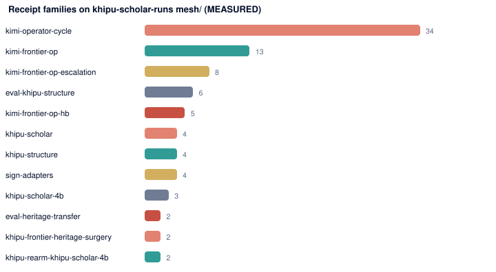

# The Truth Router — the first honesty-weighted router

Routes requests by MEASURED honesty (the cross-lab abstain census) with measured
joules/token and price as tiebreakers. Every decision returns a SHA-256 receipt
pointing at the census receipts that justify it. Fail-closed: no census, no routing.

- POST /route {task} -> routing decision receipt
- GET /registry -> the live scored model table
- GET /healthz

Honesty data: huggingface.co/datasets/SZLHOLDINGS/frontier-54-runs (census legs)

---

## Status — measured live 2026-11-14

**RUNNING** on `cpu-basic` shared hardware · **Live:** <https://szlholdings-truth-router.hf.space> · deployed revision [`ec1c87bd4b`](https://huggingface.co/spaces/SZLHOLDINGS/truth-router/tree/main)

## Estate provenance

🜂 **SZL Holdings estate artifact** — *the estate that receipts its own thinking.*

- Front door: <https://a-11-oy.com> · org: <https://huggingface.co/SZLHOLDINGS> · source: <https://github.com/szl-holdings>
- Doctrine v11 · Λ = Conjecture 1 (advisory) · estate honesty bus: <https://a-11-oy.com/api/a11oy/healthz>

## Honest limitations

- Shared `cpu-basic` hardware. No GPU or performance claims.
- This card describes function and measured status only — it is not itself a receipt. Verified estate receipts live on the tamper-evident chain and public datasets, not on this page.

---

## SZL estate showcase card

# truth router

A receipt-bearing dataset of the [SZL Holdings](https://huggingface.co/SZLHOLDINGS) estate: every artifact family carries its dated audit and source links.

- **Repo:** [SZLHOLDINGS/truth-router](https://huggingface.co/SZLHOLDINGS/truth-router)
- **Canonical source:** https://github.com/szl-holdings (org)

<!-- szl:showcase-card v1 generated 2026-11-20T06:21:10Z by szl-holdings/estate-cards weaver v0.1.0 -->

Generated by the [estate-cards weaver](https://github.com/szl-holdings/estate-cards) (stdlib Python, deterministic SVG, KANCHAY palette). Numbers labeled MEASURED/REPORTED/UNKNOWN with capture time 2026-11-20T06:21:10Z UTC; verify at source. Card id 21cd448a9a5c7bd9.